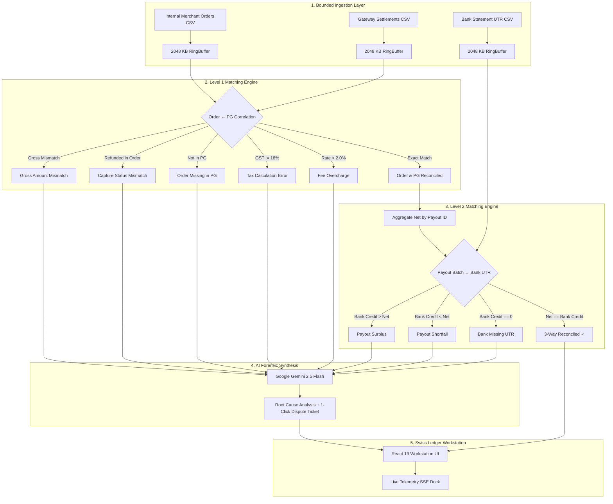

# ReconPilot — 3-Way Financial Reconciliation & AI Discrepancy Diagnosis Platform

[](https://go.dev)
[](https://react.dev)
[](https://www.postgresql.org)
[](https://ai.google.dev)
[-10B981?style=flat)](https://github.com/shopspring/decimal)

**ReconPilot** is an institutional-grade, high-throughput 3-way financial reconciliation engine and forensic audit workstation engineered in Go and React 19. It guarantees mathematical precision across high-volume merchant order ledgers, payment gateway settlement schedules (Razorpay, Stripe), and bank statement inward remittances (HDFC, ICICI, JPMorgan Chase).

---

## 1. System Architecture



---

## 2. Core Architectural Guarantees

### 2.1 Zero-Float Financial Arithmetic Guarantee
Standard IEEE-754 binary floating-point numbers (`float32`, `float64`, `double`) are mathematically incapable of representing decimal fractions like `0.1` or `0.01` without precision drift.
- **Persistence Layer:** All financial balances in PostgreSQL are enforced as `NUMERIC(18, 4)`.
- **Runtime Engine:** All calculations in Go use `github.com/shopspring/decimal` with Half-Even Banker's Rounding to 4 decimal places.
- **Zero Division Safety:** Safe division operators eliminate runtime panic hazards.

### 2.2 Zero-OOM Bounded Ring Buffer Streaming
- Files are parsed through thread-safe circular ring buffers honoring `PIPELINE_RING_BUFFER_SIZE_KB=2048`.
- Bounded memory usage protects against memory spikes or Out-Of-Memory (OOM) crashes when ingesting multi-gigabyte settlement dumps.

---

## 3. Discrepancy Classification Taxonomy

| Level | Classification | Root Cause & Failure Mode | Default Severity |
| :--- | :--- | :--- | :--- |
| **L1** | `FEE_OVERCHARGE` | Gateway charged > 2.00% agreed contract MDR rate | `HIGH` |
| **L1** | `TAX_CALCULATION_ERROR` | Gateway billed GST deviating from statutory 18.00% | `MEDIUM` |
| **L1** | `ORDER_MISSING_IN_PG` | Order marked CAPTURED internally; zero gateway settlement | `CRITICAL` |
| **L1** | `PG_ORPHAN_TXN` | Payment gateway captured funds without merchant order | `HIGH` |
| **L1** | `CAPTURE_STATUS_MISMATCH` | Order REFUNDED/FAILED internally; gateway settled funds | `HIGH` |
| **L1** | `GROSS_AMOUNT_MISMATCH` | Internal order gross volume != gateway settled gross | `HIGH` |
| **L2** | `BANK_MISSING` | Payout batch settled at PG; ZERO inward bank remittance | `CRITICAL` |
| **L2** | `PAYOUT_SHORTFALL` | Inward bank credit < expected batch net (withholding/clawback) | `CRITICAL` |
| **L2** | `PAYOUT_SURPLUS` | Inward bank credit > expected batch net (unidentified credit) | `MEDIUM` |

---

## 4. Google Gemini 2.5 Flash Discrepancy Diagnosis

Every discrepancy detected across Level 1 and Level 2 matching is automatically analyzed by Google Gemini 2.5 Flash (`gemini-2.5-flash`).

### Institutional Output Contract:
1. **Root Cause Analysis:** Forensic technical explanation detailing exactly which contract tier, fee schedule, or clearing failure occurred.
2. **Confidence Score:** 0–100% confidence rating based on arithmetic evidence.
3. **Remediation Steps:** Concrete action checklist for Treasury and Finance teams.
4. **Draft Dispute Ticket:** Formatted, copy-paste ready ticket for Razorpay, Stripe, or Bank Corporate Helpdesk containing Merchant ID, UTR, Payout Batch, exact formulas, and demanded resolution.

*Note: In offline demo mode or when no API key is configured, ReconPilot automatically activates its deterministic forensic accounting engine.*

---

## 5. API Reference Contract

All API endpoints (except `/health`) require authentication via `AUTH_API_KEY` passed in the `X-API-Key` header, `Authorization: Bearer <key>`, or `?api_key=<key>` query parameter.

```bash
# Set your API Key
export API_KEY="reconpilot-secret-dev-key"

# 1. Executive Summary KPIs
curl -s -H "X-API-Key: $API_KEY" http://localhost:8080/api/v1/summary | jq .

# 2. 3-Way Trace Items with Search & Pagination
curl -s -H "X-API-Key: $API_KEY" "http://localhost:8080/api/v1/traces?limit=10&status=discrepancy" | jq .

# 3. Payout Batch Aggregates (Level 2)
curl -s -H "X-API-Key: $API_KEY" http://localhost:8080/api/v1/payout-batches | jq .

# 4. Filter Discrepancies
curl -s -H "X-API-Key: $API_KEY" "http://localhost:8080/api/v1/discrepancies?severity=CRITICAL" | jq .

# 5. On-Demand Gemini AI Diagnosis
curl -s -X POST -H "X-API-Key: $API_KEY" http://localhost:8080/api/v1/discrepancies/<DISCREPANCY_UUID>/diagnose | jq .

# 6. Trigger Reconciliation with Custom Settlement Files
curl -X POST -H "X-API-Key: $API_KEY" \
  -F "orders_file=@samples/orders.csv" \
  -F "pg_file=@samples/pg_settlements.csv" \
  -F "bank_file=@samples/bank_statements.csv" \
  http://localhost:8080/api/v1/reconcile

# 7. Real-Time Telemetry Stream (Server-Sent Events)
curl -N -H "X-API-Key: $API_KEY" http://localhost:8080/api/v1/reconcile/stream

# 8. Export Reconciled Audit Report (CSV / JSON)
curl -s -H "X-API-Key: $API_KEY" "http://localhost:8080/api/v1/export?format=csv&target=traces" -o traces.csv
```

---

## 6. Standalone CLI Usage

ReconPilot includes a compiled standalone CLI binary (`bin/reconpilot` or `bin/reconpilot.exe`):

```bash
# Print engine version
./bin/reconpilot version

# Generate sample CSV datasets (Orders, PG Settlements, Bank Statement)
./bin/reconpilot seed --output-dir ./samples

# Run 3-way reconciliation on CSV files with instant console summary & export
./bin/reconpilot reconcile \
  --orders ./samples/orders.csv \
  --pg ./samples/pg_settlements.csv \
  --bank ./samples/bank_statements.csv \
  --export-csv ./samples/reconciliation_traces.csv \
  --export-json ./samples/reconciliation_audit.json

# Run standalone API server daemon
./bin/reconpilot serve --port 8080
```

---

## 7. Quickstart Guide

### Option A: Docker Compose (Recommended)
```bash
# 1. Clone repository
git clone https://github.com/rohn5783/ReconPilot-AI-Powered-Financial-Reconciliation-Platform.git
cd ReconPilot-AI-Powered-Financial-Reconciliation-Platform

# 2. Configure environment (optional: set your GEMINI_API_KEY)
cp .env.example .env

# 3. Launch PostgreSQL, Go API Engine, and React 19 Frontend
docker compose up --build -d

# 4. Open Workstation in Browser:
# Frontend Workstation: http://localhost:3000
# Backend API & SSE:    http://localhost:8080
```

### Option B: Local Development
```bash
# Terminal 1: Backend
cd backend
go run ./cmd/api
# Listening on http://localhost:8080

# Terminal 2: Frontend Workstation
cd frontend
npm install
npm run dev
# Workstation running on http://localhost:5173
```

---

## 8. Verification & Test Suite

Run the full end-to-end test suite:

```bash
# Backend test suites (Money, RingBuffer, Ingestion, Matching, Repository, Service, HTTP)
cd backend
go test -v -race ./...

# Frontend typechecking & production build
cd frontend
npm run build
```

---

## 9. License & Author
Engineered for institutional fintech applications. MIT License.

